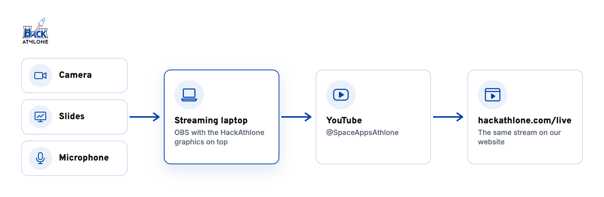
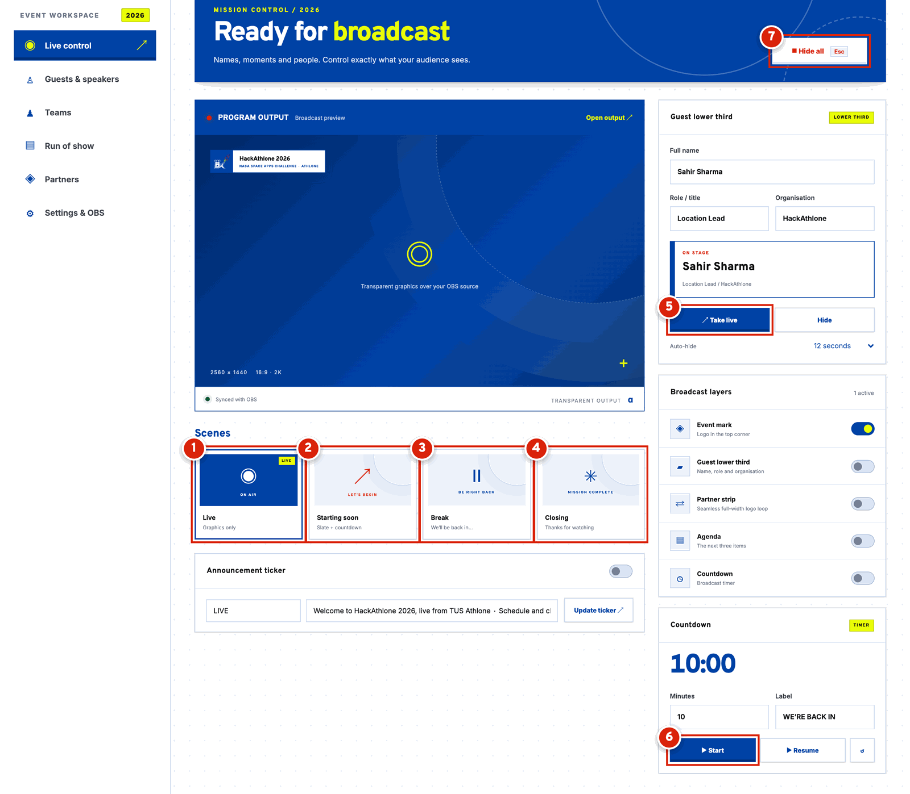
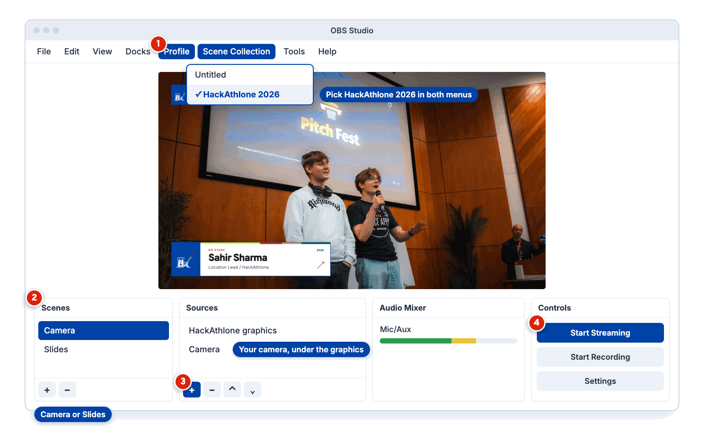
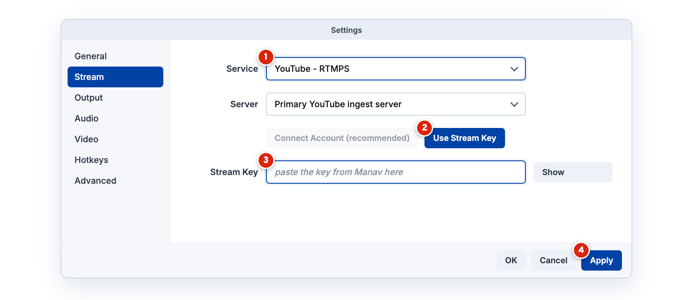
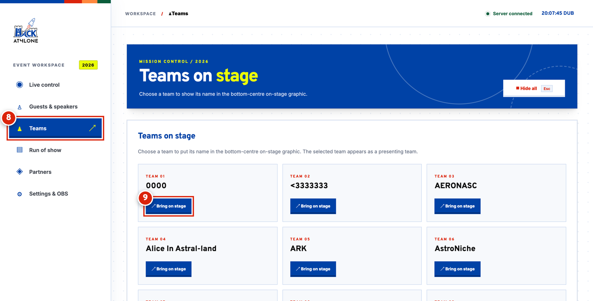
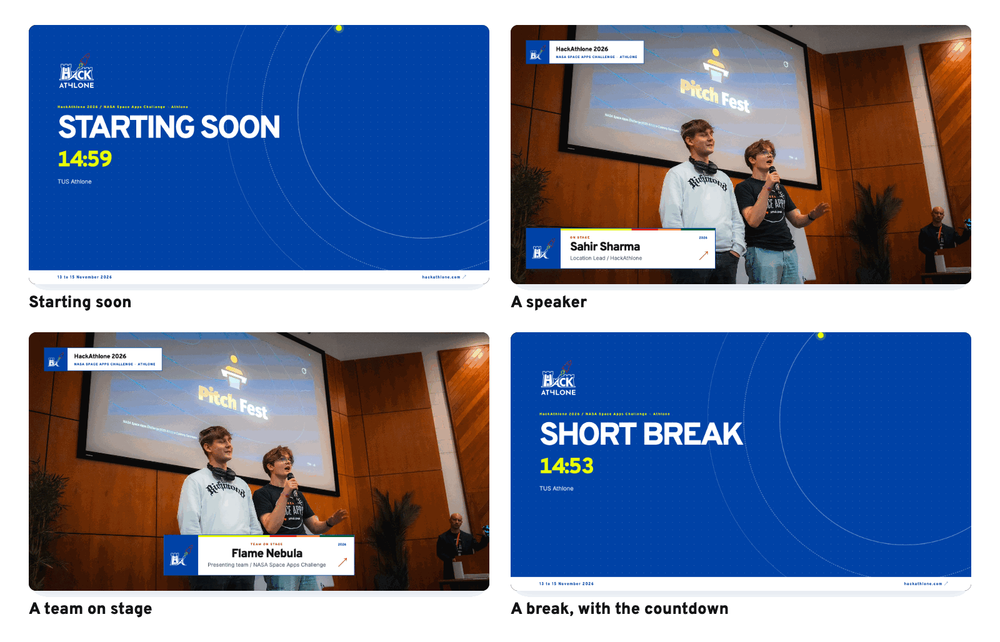

# Streaming setup

How to stream HackAthlone 2026 to YouTube from one laptop. It takes about 30 minutes the first time.

**You need:**
- a laptop, plugged in
- a camera
- the slides: an HDMI capture card, or the slides on this laptop
- a microphone
- internet, wired if possible, with 10 Mbps upload or more
- the stream key from Manav

## 1. Install two programs

1. [Node.js](https://nodejs.org): click the LTS button and install it.
2. [OBS Studio](https://obsproject.com): install it, then close it.

## 2. Start the graphics

1. On [this repo's page](https://github.com/themanavshah/hackathlone-broadcast), click **Code > Download ZIP**, then unzip it.
2. Double-click **start.cmd**. On a Mac, double-click **start.command**.
3. The control panel opens in your browser at http://127.0.0.1:3131.

Keep the black window open while you stream. If you close it, the graphics stop.

The first time you open each file:
- **Windows** may say "Windows protected your PC". Click **More info > Run anyway**.
- **Mac** may say the file can't be opened. Right-click the file, click **Open**, then **Open** again.

## 3. Set up OBS

1. Make sure OBS is closed.
2. Double-click **setup-obs.cmd**. On a Mac, double-click **setup-obs.command**. When it says Done, press any key.
3. Open OBS. Choose **HackAthlone 2026** in the **Profile** menu and again in the **Scene Collection** menu (1).
4. **Add the camera:**
   1. Click the **Camera** scene (2).
   2. Under Sources, click **+** (3), choose **Video Capture Device**, pick the camera and click **OK**.
   3. Select the camera and click the down arrow, so it sits under **HackAthlone graphics**.
   4. Right-click it and choose **Transform > Fit to screen**.
5. **Add the slides:**
   1. Click the **Slides** scene.
   2. Click **+** and choose a source:
      - **Video Capture Device** for an HDMI capture card.
      - **Display Capture** if the slides are on this laptop.
   3. Move it under the graphics and choose **Fit to screen**, the same way.
6. **Pick the microphone:** go to **Settings > Audio > Mic/Auxiliary Audio** and pick it.

## 4. Add the stream key

1. In OBS, click **Settings > Stream**.
2. Set **Service** to **YouTube - RTMPS** (1) and **Server** to **Primary YouTube ingest server**.
3. Click **Use Stream Key** (2).
4. Paste the key from Manav (3).
5. Click **Apply** (4).

The key is private. Never show it on screen or post it in a chat.

## 5. Go live

**Start Streaming in OBS puts the stream live on YouTube straight away.** Also click **Start Recording** in OBS. It keeps a copy on the laptop in case the internet drops.

The numbers in the table match the control panel picture below.

| When | Control panel | OBS |
| --- | --- | --- |
| 15 minutes before | **Starting soon** (2), then type 15 in Countdown and **Start** (6) | **Start Streaming** |
| The start | **Live** (1) | Camera |
| Someone speaks | Type their name and role, then **Take live** (5). It hides itself after 12 seconds. | Camera |
| Slides | | Slides |
| A team presents | **Teams** (8), then **Bring on stage** (9) | Slides |
| A break | **Break** (3). Type the minutes in Countdown, then **Start** (6) | |
| The end | **Closing** (4), then wait 30 seconds | **Stop Streaming** |

**Hide all** (7), or the Esc key, clears every graphic at once.

**What viewers see:**

**Sunday:**
- **Times:** sessions start at 11:30, 13:15 and 15:00. There are 15 minute breaks at 13:00 and 14:45. The judges deliberate from 16:30, and the awards start at 17:30.
- **The team list:** Manav sends the final list before 11:30. Load it in **Settings & OBS > Import JSON**.

## If something goes wrong

- **No graphics in OBS:** the black window was closed.
  1. Double-click **start.cmd** again.
  2. In OBS, right-click **HackAthlone graphics** and choose **Refresh**.
- **A red square in OBS, or dropped frames:** the internet is too slow.
  1. Use a cable instead of Wi-Fi.
  2. In **Settings > Output**, set the bitrate to 3500.
- **YouTube shows no data:** check the stream key, and check that the service is **YouTube - RTMPS**.
- **Echo:** go to **Settings > Audio** and set **Desktop Audio** to **Disabled**.
- **You need to stop fast:** click **Hide all** (7), then **Stop Streaming**.

## Links

- Friday 18:00, Opening Ceremony: https://www.youtube.com/watch?v=x4-fKxqCFGc
- Sunday 11:30, Final Presentations and Awards: https://www.youtube.com/watch?v=pogVpwtTwBA
- The stream on our website: https://hackathlone.com/live

Stuck? Ask Manav.
